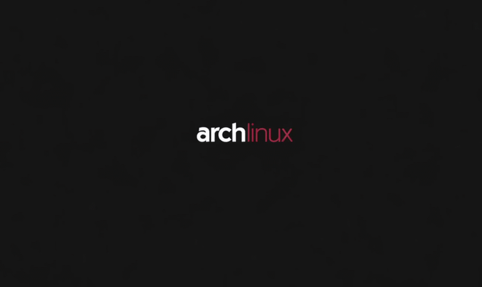
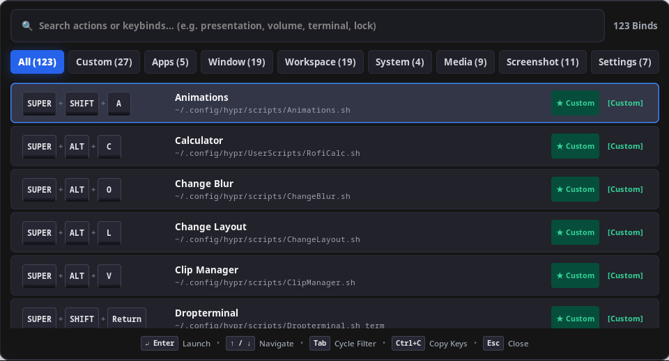
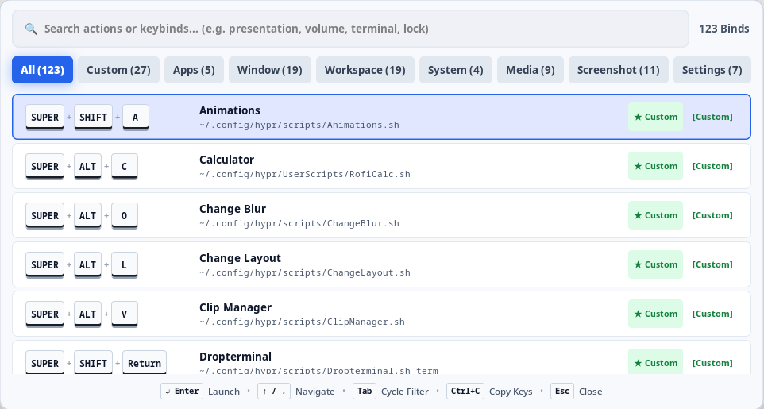

<div align="center">

# hyprwhich

**A Wayland Layer-Shell HUD and keybinding lookup tool for Hyprland, written in Rust.**

<p>
  <code>hyprwhich</code> parses your Hyprland configuration files (<code>.conf</code> and <code>.lua</code>) and opens a fast, searchable overlay cheatsheet via Wayland Layer-Shell.
</p>



</div>

---

## Previews

| Dark Mode (Wallust palette) | Light Mode (High Contrast) |
| :---: | :---: |
|  |  |

---

## Features

- **Fast startup**: Standalone compiled Rust binary using `gtk-layer-shell`. Opens in ~15ms with low resource usage.
- **Wayland Layer-Shell integration**: Runs on the `Overlay` layer above fullscreen apps without disrupting window layouts or tiling rules.
- **Automatic theme sync**: Detects dark or light mode from `~/.cache/.theme_mode`, active Waybar styling symlink, `wallust.toml`, or `gsettings`.
- **High contrast**: Clear color palette for both light and dark themes with distinct, readable category labels.
- **Parser**: Recursively parses `.conf` and `.lua` files, expanding variables (`$mainMod`, `$scriptsDir`, `$term`, `$files`, etc.).
- **User custom bindings**: Identifies custom scripts and binds, tagging them with a `★ Custom` badge.

---

## Controls

| Key | Action |
| :--- | :--- |
| `↵ Enter` | Launch selected keybind and close HUD |
| `↑` / `↓` | Navigate list |
| `Tab` | Cycle next category filter |
| `Shift + Tab` | Cycle previous category filter |
| `Ctrl + C` | Copy key combination to clipboard |
| `Esc` | Clear search query or close HUD |

---

## Installation

### Arch Linux (AUR)
```bash
yay -S hyprwhich
# or
paru -S hyprwhich
```

### Install script
```bash
git clone https://github.com/hyprwhich/hyprwhich.git
cd hyprwhich
./install.sh

# Or with custom options:
# ./install.sh --no-bind        # Install binary only
# ./install.sh --key SLASH      # Custom hotkey (default: H)
# ./install.sh --bin-dir /opt/bin
```

### Build from source
```bash
cargo build --release
install -Dm755 target/release/hyprwhich ~/.local/bin/hyprwhich
ln -sf ~/.local/bin/hyprwhich ~/.local/bin/hyprwhich-gui
```

---

## Hyprland Configuration

Add to your `~/.config/hypr/UserConfigs/UserKeybinds.conf` (or `hyprland.conf`):

```ini
# Bind hyprwhich to Super + H
bind = $mainMod, H, exec, hyprwhich
```

Or for Lua configs (`UserKeybinds.lua`):

```lua
hl.bind(mainMod .. " + H", hl.dsp.exec_cmd("hyprwhich"))
```

---

## CLI Usage

`hyprwhich` can also query keybinds from the terminal:

```bash
# Open Wayland HUD (default)
hyprwhich

# Force light theme
hyprwhich --light

# Print table to terminal
hyprwhich --list

# Output JSON
hyprwhich --json

# Output TSV
hyprwhich --tsv

# Benchmark parser latency
hyprwhich --bench
```

---

## Project Structure

```
hyprwhich/
├── Cargo.toml
├── LICENSE
├── PKGBUILD
├── install.sh
├── README.md
├── assets/
│   ├── dark_hud.png
│   ├── demo.gif
│   └── light_hud.png
└── src/
    ├── main.rs     # CLI options, benchmarks, entrypoint
    ├── config.rs   # Parser (.conf and .lua), variable expansion
    ├── theme.rs    # Theme detection and CSS generation
    └── gui.rs      # Layer-Shell HUD window and navigation
```

---

## License

This project is licensed under the MIT License - see the [LICENSE](LICENSE) file for details.
